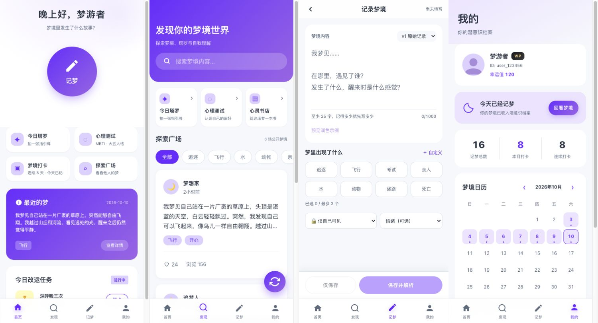

# 梦见产品升级原型

这是可直接评审的静态 HTML 原型，保留梦境记录、解析、探索广场、任务、积分、会员、成就与设置，并在四个 Tab 中加入塔罗、心理测试、打卡日历和静态心灵书店。



## 本地预览

在仓库根目录运行：

```bash
python3 design/serve.py 4175
```

打开 [http://127.0.0.1:4175/index.html](http://127.0.0.1:4175/index.html)。`serve.py` 默认关闭缓存，避免评审时混入旧页面。

## 评审主路径

1. 首页 → 记梦，先写下片段，输入框随文字增高，并显示距离 25 字还差多少。常用与自定义标签合计最多 3 个；标签下方一行可直接选择公开范围与 14 种情绪，选“情绪（可选）”可清空情绪。
2. 编辑区可预览润色示例，确认应用后才切换版本，原始与润色内容分别保留。底部可“仅保存”或“保存并解析”；编辑已有记录时可“保存并重新解析”。返回或切换 Tab 前会提示未保存的修改。
3. 解析结果展示按梦境主题匹配的延伸阅读。
4. 延伸阅读 → 书店，按分类查看并收藏；我的 → 我的书架查看收藏。
5. 发现页可搜索、按主题筛选公开梦境、点赞、查看公开详情和作者档案。
6. 我的页可查看打卡统计、日历并切换月份；设置中可切换暗色模式。
7. 发现页还包含每日一牌/三牌阵、MBTI 8 题和大五人格 5 题。

## 范围说明

塔罗、测试、解析、运势和历史日历使用演示数据，不调用 AI 或后端。书籍收藏与主题保存在当前浏览器的本地设置中；当前梦境及原始/润色版本只保留在当前浏览器会话中。历史日历示例仅供查看与对比，避免修改示例时覆盖当前梦境。

记梦不会自动提交或持久保存草稿，显式保存才会更新当前梦境。润色为静态示例，预览内明确说明来源。页面内离开使用确认框，刷新或关闭使用浏览器离开提示；移动浏览器强制关闭时无法保证出现提示。底部操作栏按可视区域调整，软键盘仍需真机验证。

会员、成就、分享及隐私/导出入口沿用参考页面；本轮没有接入账号、广告、真实导出、微信分享、商城、支付、订单或外部导购。

## 自检

```bash
node design/content-self-check.cjs
node design/core-self-check.cjs
node design/record-self-check.cjs
node design/profile-self-check.cjs
```

四个脚本均覆盖当前页面的主要交互和边界条件。已在浏览器验证记梦、编辑与版本切换、主题书单、收藏/空书架、社区筛选与作者档案、两种塔罗和两种测试，并检查 320/390 像素布局及暗色模式。
